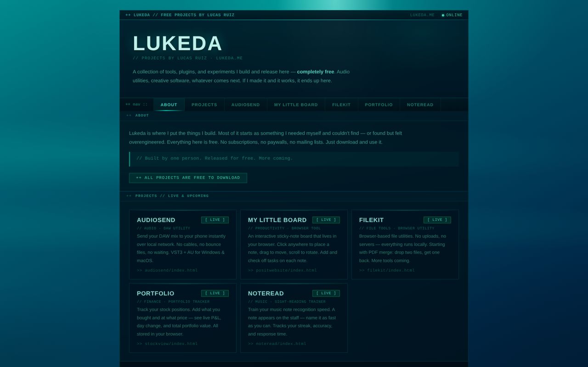
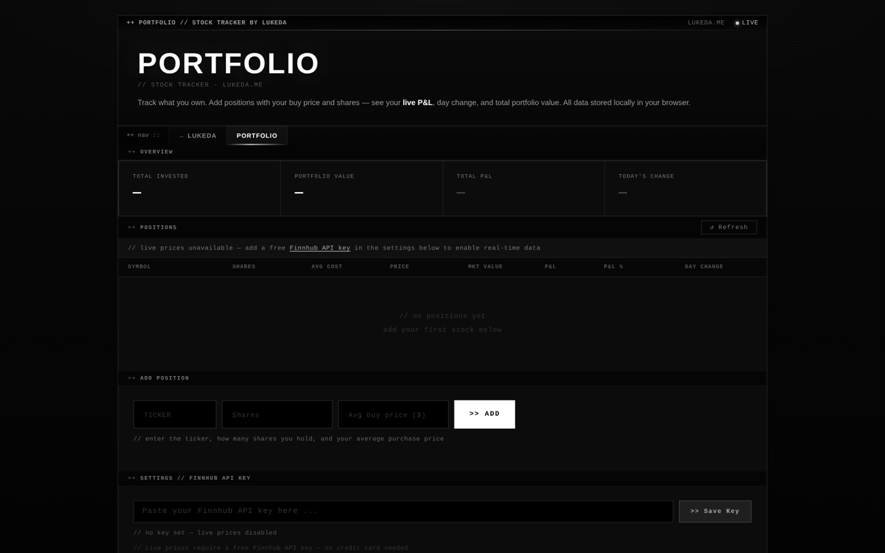
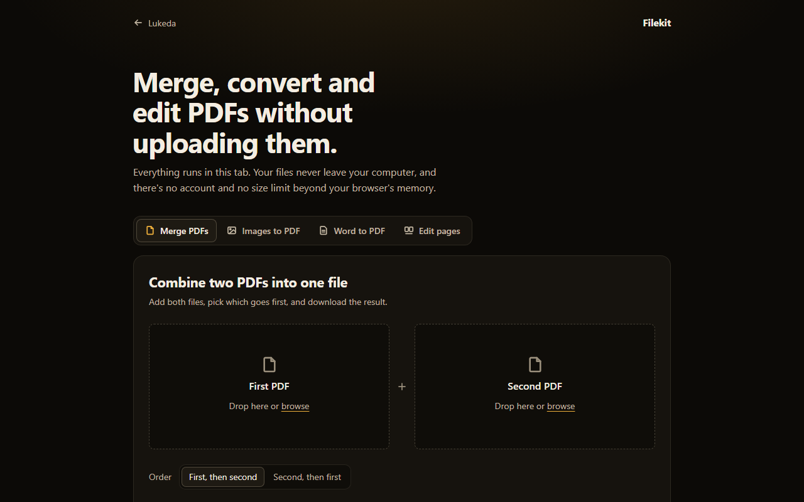
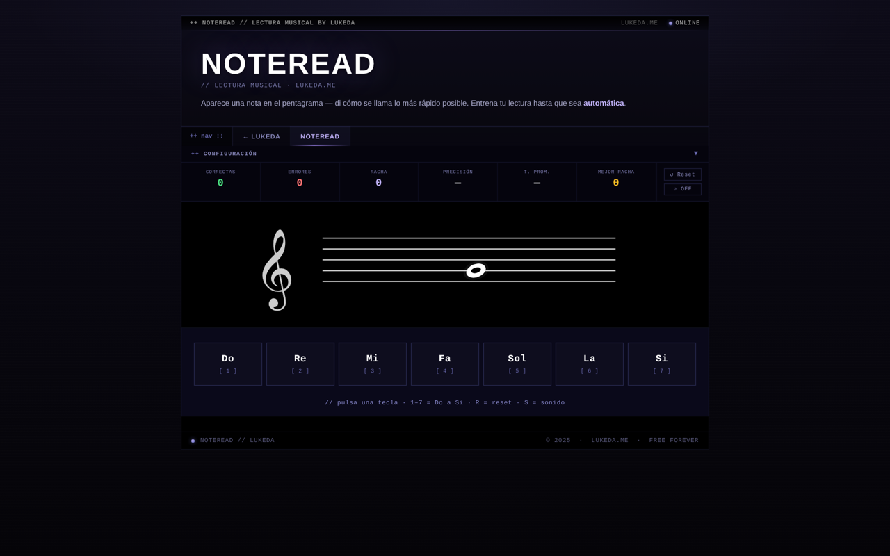
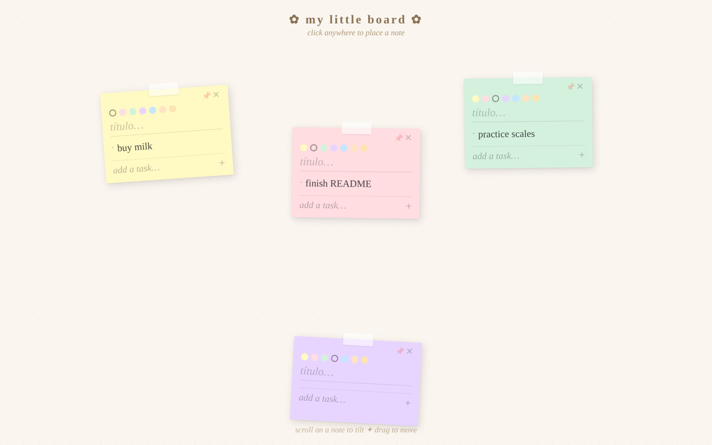
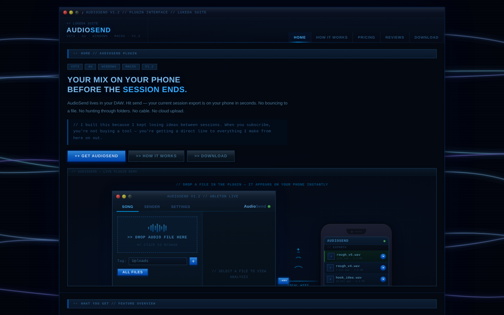
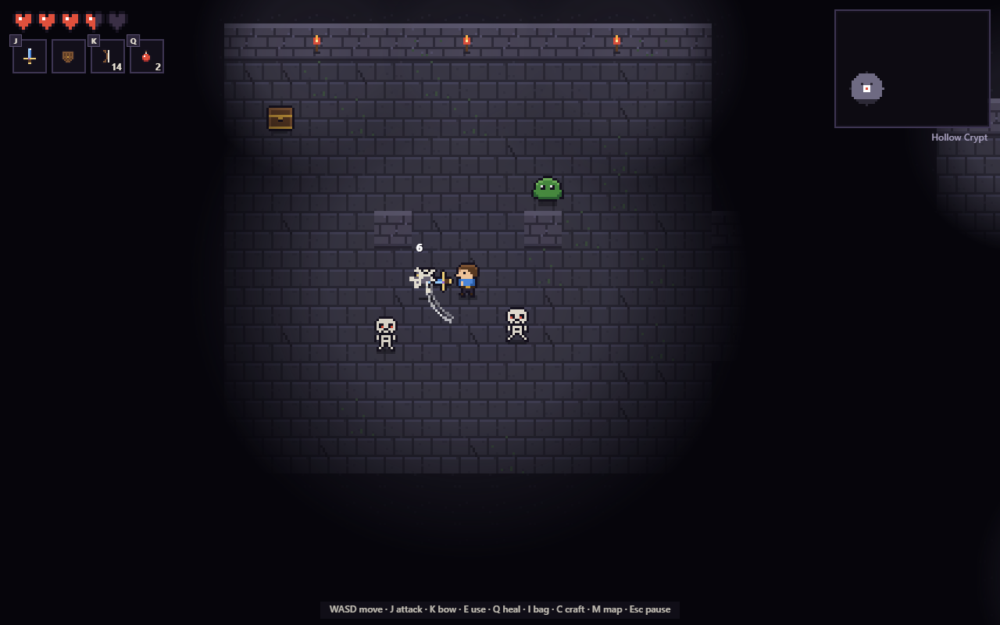

# Lukeda · [lukeda.me](https://lukeda.me)

Tools I build because I needed them and couldn't find a good free version. Everything is free: no accounts, no paywalls, no tracking. Most tools run entirely in your browser, so your files and data never leave your device.



## Projects

| Project | What it does | Built with |
|---|---|---|
| [**AudioSend**](https://github.com/LucasRuizGomez/Audiosend) | Free VST3 plugin for Windows that sends your exports to your phone over local Wi-Fi. Scan a QR code, listen in the browser and check loudness (LUFS, true peak). Source code in [its own repo](https://github.com/LucasRuizGomez/Audiosend). | C++, JUCE |
| [**Portfolio**](https://lukeda.me/stockview/) | Stock portfolio tracker. Add your positions and see live prices, P&L, daily change and total value. | JavaScript, Finnhub API, `localStorage` |
| [**Filekit**](https://lukeda.me/filekit/) | File tools that run in the browser: merge PDFs, convert images and Word documents to PDF, and edit PDF pages, without uploading anything. | JavaScript, pdf-lib, PDF.js |
| [**NoteRead**](https://lukeda.me/noteread/) | Sight-reading trainer. A note appears on the staff and you name it as fast as you can. Tracks accuracy, streaks and reaction time. | JavaScript, SVG, Web Audio API |
| [**My Little Board**](https://lukeda.me/positwebsite/) | Sticky-note board. Click anywhere to add a note, drag to move, scroll to rotate, and keep a checklist on each note. | JavaScript, `localStorage` |
| [**RPG**](https://lukeda.me/rpg/) *(demo)* | Top-down tile-based RPG prototype. | JavaScript, Canvas |

## Screenshots

| Portfolio | Filekit |
|---|---|
|  |  |
| **NoteRead** | **My Little Board** |
|  |  |
| **AudioSend** | **RPG demo** |
|  |  |

## How it's built

- **No frameworks.** Each tool is a self-contained HTML page with vanilla JavaScript and CSS, served by GitHub Pages under a custom domain.
- **Local first.** Tools process files and store data in the browser. Nothing is uploaded, and there's no account system.
- **Tested.** Each tool has a `tests.html` page with its own test suite. Open it in the browser to run the tests.
- **One design system.** Every tool shares the same retro terminal layout, with its own colour palette.

## Run locally

```bash
git clone https://github.com/LucasRuizGomez/LucasRuizGomez.github.io.git
cd LucasRuizGomez.github.io
python -m http.server 8000
```

Then open `http://localhost:8000`. Portfolio needs a free [Finnhub](https://finnhub.io) API key for live prices; you paste it into the page's settings, and it stays in your browser.

---

Built by [Lucas Ruiz Gómez](https://www.linkedin.com/in/lucas-ruizgomez).
